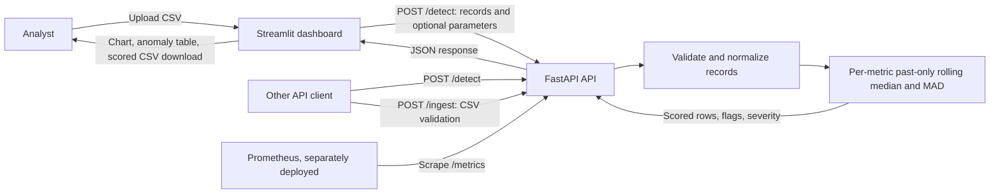

# Anomaly Detection for Business Metrics

A Python reference application for scoring business time-series data with an explainable, past-only rolling median and median absolute deviation (MAD) detector. It provides a FastAPI service, a Streamlit dashboard, a seeded synthetic dataset, and a Docker Compose demo deployment.

This repository is an MVP and learning/reference project, not a production-ready monitoring service. It has no authentication, authorization, durable storage, or business alert delivery. Treat scores as signals for investigation, not as proof of an incident.

## Contents

- [Real-world use cases](#real-world-use-cases)
- [Architecture](#architecture)
- [Technical stack](#technical-stack)
- [Quick start](#quick-start)
- [Input data and detection behavior](#input-data-and-detection-behavior)
- [API reference](#api-reference)
- [Configuration](#configuration)
- [Development and testing](#development-and-testing)
- [Deployment, operations, and limitations](#deployment-operations-and-limitations)
- [Repository layout](#repository-layout)
- [Further documentation](#further-documentation)

## Real-world use cases

The pattern in this project can support an analyst or operations team investigating unexpected changes in regularly reported metrics, for example:

- **E-commerce operations:** flag unusual daily order counts, revenue, refunds, or conversion-rate changes.
- **Subscription and product analytics:** spot sudden shifts in sign-ups, active users, or feature usage.
- **Service and business operations:** identify changes in ticket volume, fulfillment time, or other numeric operational measures.

For example, an e-commerce analyst could export daily orders and revenue, upload the CSV, review flagged dates and scores, and compare those dates with promotions, outages, or reporting changes. The app does not identify a cause, send alerts, or connect to those business systems; an operator must validate the signal and investigate it.

The checked-in `sample_data/business_metrics.csv` contains seeded synthetic examples for `daily_orders`, `conversion_rate_pct`, and `revenue_usd`. It is for demonstration only and does not establish detection accuracy on real business data.

## Architecture



The API validates and normalizes each record, sorts observations by metric and timestamp, then scores each metric independently using only preceding observations for its rolling baseline. It returns the baseline, robust z-score, anomaly flag, direction, and severity. The service is stateless: request data and results are held in memory for processing and are not saved to a database or file by the application.

The dashboard reads an uploaded CSV and sends its rows as JSON to `/detect`. `/ingest` is a separate API endpoint that validates and normalizes an uploaded CSV and returns the normalized records; it does not run anomaly detection. The Prometheus configuration is an example scrape target, not a Prometheus service included in Docker Compose.

## Technical stack

- **Python 3.11+**
- **FastAPI**, **Pydantic 2**, and **Uvicorn** for the HTTP API and request validation
- **Pandas** and **NumPy** for record normalization, time-series processing, and seeded synthetic data
- **Streamlit**, **Plotly**, and **Requests** for the interactive dashboard and API calls
- **prometheus-client** for the `/metrics` endpoint
- **pytest**, **HTTPX**, **Ruff**, and **pip-audit** for development and CI
- **Docker** and **Docker Compose** for the local two-service demonstration

Runtime and development dependencies and their supported version ranges are declared in `pyproject.toml`.

## Quick start

### Local Python setup

Use Python 3.11 or later. From the repository root, install the project and development tools:

```shell
python -m venv .venv
```

Activate the environment, then install the package:

```shell
# macOS/Linux
source .venv/bin/activate

# Windows PowerShell
.\.venv\Scripts\Activate.ps1

python -m pip install -e ".[dev]"
```

Start the API and dashboard in separate terminals from the repository root:

```shell
uvicorn anomaly_detection.api:app --reload
```

```shell
streamlit run dashboard/app.py
```

The API listens at `http://localhost:8000`, with interactive OpenAPI documentation at `http://localhost:8000/docs`. The dashboard opens at `http://localhost:8501` and defaults to the API at `http://localhost:8000`. To use another API address, set `API_BASE_URL` in the dashboard process environment before starting Streamlit.

Upload `sample_data/business_metrics.csv` in the dashboard to try the full workflow. The dashboard shows row and anomaly counts, an anomaly rate, a selectable metric time-series chart with flagged points, a table of anomalous rows, and a download of the complete scored dataset.

### Docker Compose

Copy `.env.example` to `.env`, then run:

```shell
docker compose up --build
```

Compose starts the API on port `8000` and the dashboard on port `8501`. The dashboard is configured to reach the API at `http://api:8000` over the Compose network. The API health check calls `/health`; the dashboard waits for the API health check to pass. Stop the services with `Ctrl+C`, or use `docker compose down` from another terminal.

The example `.env` is read by Compose for the API service; Compose sets the dashboard's `API_BASE_URL` separately. A local Python process does not automatically load `.env`: set configuration variables in that process's environment when needed.

## Input data and detection behavior

Each observation is one metric value at one point in time:

| Field | Requirement |
| --- | --- |
| `timestamp` | Required ISO-8601 timestamp; normalized to UTC |
| `metric` | Required nonblank string, at most 100 characters |
| `value` | Required finite number |
| `source` | Optional string, at most 100 characters |

Additional fields are rejected. Duplicate `(timestamp, metric)` pairs are rejected after timestamp normalization. Rows from different metrics may share timestamps. CSV inputs use the same required columns, with `source` optional.

The detector sorts each metric's observations chronologically and compares each value with a rolling baseline derived from prior values only. The default baseline window is 14 observations; at least 7 prior observations are required before a row can be scored. The score uses the median and a MAD-based scale so isolated extreme values have less influence on the baseline than they would with a mean and standard deviation. A row is anomalous when its absolute robust z-score reaches the configured threshold and a baseline is available.

`direction` is `high`, `low`, or `normal`. An anomalous row is `critical` when its absolute robust z-score is at least twice the threshold; other anomalous rows are `warning`. Rows without sufficient history have no usable baseline and are not flagged. These labels and defaults are simple heuristics: tune and evaluate them on representative, labeled historical data before operational use.

The approach is intended for basic spike/drop detection. It can miss or misclassify seasonal behavior, sparse series, gradual drift, sustained level shifts, data-quality problems, and changes in reporting cadence. It does not forecast values, discover causes, or automatically adjust for calendar effects.

## API reference

Interactive endpoint schemas and examples are available at `http://localhost:8000/docs` while the API is running.

| Method and path | Purpose |
| --- | --- |
| `GET /` | Service name, version, and docs path |
| `GET /health` | Basic health status and configured environment name |
| `GET /metrics` | Prometheus-format HTTP request, latency, and scored-observation metrics |
| `POST /detect` | Validate and score a JSON list of metric records |
| `POST /ingest` | Validate and normalize a `.csv` upload; does not score it |

Example detection request:

```shell
curl -X POST http://localhost:8000/detect \
  -H "Content-Type: application/json" \
  -d '{
    "records": [
      {"timestamp": "2026-01-01T00:00:00Z", "metric": "daily_orders", "value": 220},
      {"timestamp": "2026-01-02T00:00:00Z", "metric": "daily_orders", "value": 224},
      {"timestamp": "2026-01-03T00:00:00Z", "metric": "daily_orders", "value": 390}
    ],
    "threshold": 3.5,
    "window": 14,
    "min_history": 7
  }'
```

`threshold`, `window`, and `min_history` are optional. When omitted, the service uses its configured threshold, rolling window, and minimum history. The request permits 1–100,000 records; `threshold` must be greater than 0 and at most 100, and the window and minimum history must each be between 2 and 365, with minimum history no greater than the window. A response contains `count`, `anomaly_count`, and a `results` array. Each result includes the normalized input fields plus `baseline`, `robust_z`, `is_anomaly`, `direction`, and `severity`; baseline and score can be `null` when insufficient history is available.

Invalid JSON record contracts and invalid detection parameters return HTTP 422. `/ingest` requires a filename ending in `.csv`, limits the read to `MAX_UPLOAD_BYTES`, and returns HTTP 400 for an invalid file type, 413 for an oversized file, or 422 for invalid CSV contents.

## Configuration

| Variable | Default | Purpose |
| --- | --- | --- |
| `APP_ENV` | `local` | Environment label returned by `/health` |
| `ANOMALY_THRESHOLD` | `3.5` | Default absolute robust z-score threshold |
| `ROLLING_WINDOW` | `14` | Number of prior observations used for the rolling baseline |
| `MIN_HISTORY` | `7` | Minimum prior observations before scoring |
| `MAX_UPLOAD_BYTES` | `5000000` | Maximum CSV bytes read by `POST /ingest` |
| `API_BASE_URL` | `http://localhost:8000` | API origin used by the Streamlit dashboard |

The first five settings are read by the API process. `API_BASE_URL` is read by the dashboard. The detection endpoint also accepts per-request `threshold`, `window`, and `min_history` overrides. The byte limit applies to `/ingest`; the dashboard uploads a CSV to Streamlit and then submits its rows to `/detect`, so it is not a general upload limit for the dashboard flow.

## Development and testing

Run the test suite, linter, and dependency audit locally:

```shell
pytest -q
ruff check .
pip-audit
```

Continuous integration runs these checks on pushes, pull requests, and manual dispatch using Python 3.11. Tests cover detector behavior, duplicate input rejection, and basic API health/detection responses.

To regenerate the checked-in synthetic CSV:

```shell
python scripts/generate_sample_data.py
```

The generator uses a fixed NumPy seed and writes 120 daily observations for each of three example metrics. It includes injected high and low changes for dashboard demonstrations; the generated data is not a labeled evaluation dataset.

## Deployment, operations, and limitations

Docker Compose is provided for local demonstration, not hardened public deployment. Before connecting real business data or exposing the service outside a trusted environment, implement and review at least:

- Authentication and authorization, TLS termination, network restrictions, and rate limits
- Managed secrets and an explicit data retention/privacy policy
- Durable storage, backups, and restore procedures if results or source records must persist
- Capacity, concurrency, upload-size, dependency, and security testing for the target environment
- A validated alerting and incident workflow; the dashboard itself does not deliver alerts

The service processes data in memory and has no database, persistence, user accounts, or tenant isolation. The dashboard sends uploaded record values to the API. Do not upload confidential or personal data to an unapproved deployment. The Compose file does not start Prometheus; `monitoring/prometheus.yml` and `monitoring/alerts.yml` are examples that require a separately deployed Prometheus instance and an appropriate network target. The included alert rule only detects when the configured API scrape target is down.

Use `docs/evaluation_plan.md` to plan evaluation on labeled historical data. It calls for precision, recall, F1, false positives per metric-day, and detection delay, with tuning on validation data and reporting on held-out test data. `docs/benchmark-results.md` records that no benchmark has been run and specifies measurements to collect before making performance claims. Operational deployment, incident response, and rollback guidance are in `runbooks/`.

## Repository layout

```text
.
├── dashboard/                 # Streamlit user interface
├── deployment/                # Deployment notes
├── docs/                      # Architecture, data, evaluation, threat model, ADR
├── monitoring/                # Prometheus scrape and example alert configuration
├── runbooks/                  # Deployment, incident response, and rollback guidance
├── sample_data/               # Seeded synthetic business metrics CSV
├── scripts/                   # Synthetic dataset generator
├── src/anomaly_detection/     # API, configuration, validation, and detector
├── tests/                     # API, detector, and validation tests
├── Dockerfile
├── docker-compose.yml
└── pyproject.toml
```

## Further documentation

- [`docs/architecture.md`](docs/architecture.md) — service flow and behavior
- [`docs/adr/0001-detection-method.md`](docs/adr/0001-detection-method.md) — detector choice and tradeoffs
- [`docs/data_dictionary.md`](docs/data_dictionary.md) — input/output fields
- [`docs/evaluation_plan.md`](docs/evaluation_plan.md) — accuracy evaluation plan
- [`docs/benchmark-results.md`](docs/benchmark-results.md) — benchmark status and measurement plan
- [`docs/threat_model.md`](docs/threat_model.md) — security considerations
- [`deployment/README.md`](deployment/README.md) — deployment caveats
- [`monitoring/`](monitoring/) — Prometheus configuration examples
- [`runbooks/`](runbooks/) — operational procedures
